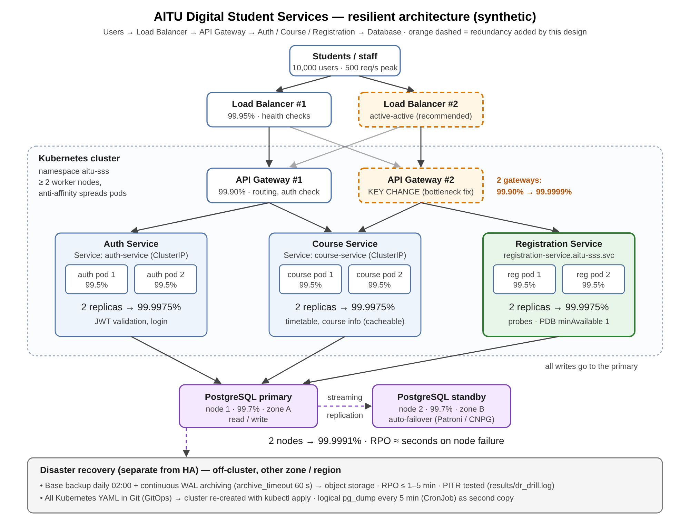
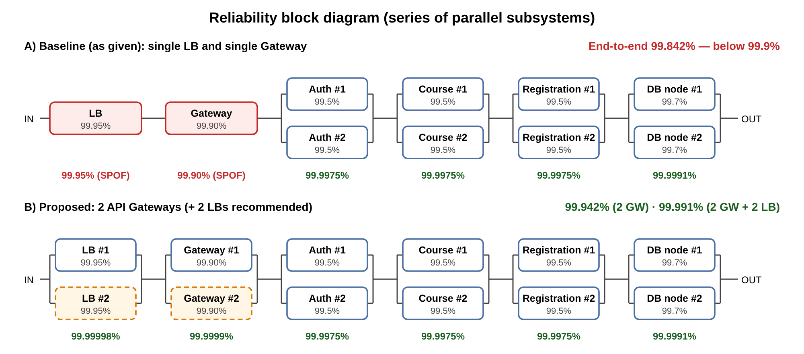

> **Context note.** All operational data in this report is synthetic educational data. It does not describe real AITU infrastructure, incidents, endpoints or credentials.
>
> Fields marked **[FILL IN]** must be completed by the student personally.

# 1. Student and Submission Information

| Required field | Student entry |
|---|---|
| Student full name | [FILL IN] |
| Student ID | [FILL IN] |
| Group / cohort | [FILL IN] |
| Instructor | [FILL IN] |
| Date of submission | [FILL IN] |
| Individual variant / task code assigned by instructor | [FILL IN] |
| Git repository / project link | https://github.com/a169n/fault_3 [FILL IN: branch / commit hash] |
| Attached code / file names | `k8s/11-registration-deployment.yaml`, `k8s/12-registration-service.yaml`, `k8s/13-registration-pdb.yaml`, `k8s/20-db-backup-cronjob.yaml`, `app/registration_service.py`, `scripts/availability.py`, `scripts/simulate_failures.py`, `scripts/k8s/run_experiments.py`, `scripts/dr_drill.sh`, `docs/architecture.png`, `docs/rbd.png`, `results/*` |

# 2. Work Period and Task Record

| Item | Student entry |
|---|---|
| Work start date/time | [FILL IN] |
| Work completion date/time | [FILL IN] |
| Main task completed | Resilient architecture for the synthetic AITU student-services platform: availability model, Kubernetes resilience design for the Registration Service, failure experiments, RPO/RTO and DR plan |
| Tools / technologies used | Kubernetes (Deployment, Service, PodDisruptionBudget, CronJob, StatefulSet, probes), Docker, kind, kubectl, kubeconform, Python 3, PostgreSQL 16 (pg_dump, pg_basebackup, WAL archiving, PITR), Git |
| Main technical output produced | Kubernetes YAML (validated against the Kubernetes 1.31 schema), a Registration microservice with liveness and readiness endpoints, an availability calculator, a failure simulator, scripts for real-cluster experiments, a DR drill script, measured results |

# 3. Report Structure

## 3.1 Architecture Analysis (Part A)

**Architecture:** Users → Load Balancer → API Gateway → Auth / Course / Registration → Database.

{width=100%}

| Component | Failure scenario | Effect on student service | Resilience mechanism |
|---|---|---|---|
| **Load Balancer** | Instance crash, misconfiguration, zone outage, traffic flood during the registration period | Single entry point: **the whole platform is unreachable**, even though every backend is healthy (single point of failure, 99.95%) | Two LB instances active-active, or a managed multi-zone cloud LB. Health checks on the gateways. DNS failover with a short TTL. Rate limiting. |
| **API Gateway** | Process crash or hang, overload at 500 req/s, bad routing config after a deploy | **All API calls fail** (login, timetable, registration). It is the weakest link in series: 99.90% on its own uses the whole 99.9% budget | **2+ replicas** behind the LB (key change). Liveness and readiness probes. Rolling updates with `maxUnavailable: 0`. Timeouts and circuit breakers towards the backends so that one slow service cannot block the gateway. |
| **Auth** | One replica crashes. Signing-key or config error. Auth DB unavailable. | New logins fail. If tokens are validated by calling Auth, every request fails. | **2 replicas** + probes + PDB. **Stateless JWT**: the other services validate tokens locally with the public key, so users who are already logged in keep working while Auth is down. |
| **Course** | One replica crashes, slow DB queries | Timetable and course-information lookup fail or are slow | **2 replicas** + probes. Read-heavy data is cacheable (cache or CDN with a TTL; serve stale timetable data rather than an error). |
| **Registration** | Replica crash, deadlock or hang, DB connection exhaustion, DB unavailable | Students cannot submit or view registrations. This is the most critical function during the registration week (peak load). | **2 replicas** on different nodes (anti-affinity). Readiness probe tied to the DB. Liveness independent of the DB. PDB `minAvailable: 1`. Fast-fail `503 + Retry-After`, so clients retry instead of hanging. Idempotent requests are recommended for safe retries. |
| **Database** | Primary node failure, disk full, data corruption, human error (`DROP TABLE`) | All writes fail (registration). Reads fail for every service. Corruption or human error means **data loss**. | **2 nodes**: primary + streaming standby in another zone, with automatic failover (Patroni or CloudNativePG). Connection pooling. **Backups with history** (base backup + WAL archive → PITR) for errors that replication would copy. |

| Required content | Student response / evidence |
|---|---|
| **Summary** | The services behind the gateway are already redundant (2 replicas each). The real single points of failure are the **Load Balancer and the API Gateway**: both are single instances in the given design. The database is redundant against node failure, but replication does not protect against logical errors, so DR backups are needed as well. |
| **Evidence / artifact reference** | `docs/architecture.svg` / `.png`, `docs/rbd.png`, table above. For the Registration Service the mechanisms are implemented in `k8s/11-registration-deployment.yaml`, `k8s/12-registration-service.yaml` and `k8s/13-registration-pdb.yaml`. |
| **Student-specific decision or observation** | The liveness probe does **not** check the database; only the readiness probe does. If liveness depended on the DB, a DB outage would make the kubelet restart every healthy Registration pod in a loop (a restart storm), which adds load and hides the real cause. Experiment 3 confirms this: the DB was down for 30 s and there were **0 pod restarts**. |

## 3.2 Availability Calculation (Part B)

Formula for two independent replicas: **R_parallel = 1 − (1 − R1)(1 − R2)**. Series: **R = R1 × R2 × … × Rn**.
The calculation is reproducible with `python3 scripts/availability.py` (output in `results/availability.md`).

| Subsystem | Configuration | Calculation | Availability |
|---|---|---|---|
| Auth | 2 replicas | 1 − (1 − 0.995)² = 1 − 0.000025 | **99.9975%** |
| Course | 2 replicas | 1 − (1 − 0.995)² = 1 − 0.000025 | **99.9975%** |
| Registration | 2 replicas | 1 − (1 − 0.995)² = 1 − 0.000025 | **99.9975%** |
| Database | 2 nodes | 1 − (1 − 0.997)² = 1 − 0.000009 | **99.9991%** |
| End-to-end | Series LB × GW × Auth × Course × Registration × DB | 0.9995 × 0.9990 × 0.999975³ × 0.999991 | **99.8417%** |

{width=100%}

**1. Does the design meet 99.9%?** **No.** 99.8417% means about **13.9 h of downtime per year** (68 min per month). The target 99.9% allows only 8.76 h per year (43 min per month).

**2. Which component is the bottleneck?** The **API Gateway** (single instance, 99.90%). It causes 63% of the expected downtime, and the single LB causes another 32%. On its own the gateway already equals the target, so any other component in series pushes the result below 99.9%.

| Subsystem | Unavailability | Share of total downtime |
|---|---|---|
| API Gateway | 0.1000% | 63.1% |
| Load Balancer | 0.0500% | 31.6% |
| Auth / Course / Registration (each) | 0.0025% | 1.6% |
| Database | 0.0009% | 0.6% |

**3. Which redundancy change has the largest effect?** **A second API Gateway replica.**

| Change | End-to-end | Downtime h/year | Meets 99.9%? |
|---|---|---|---|
| Baseline | 99.8417% | 13.87 | no |
| 3 replicas of Auth / Course / Registration | 99.8491% | 13.22 | no |
| 3 database nodes | 99.8426% | 13.79 | no |
| 2 Load Balancers | 99.8916% | 9.50 | no |
| **2 API Gateways** | **99.9415%** | **5.12** | **yes** |
| 2 LBs + 2 API Gateways | 99.9915% | 0.75 | yes |

| Required content | Student response / evidence |
|---|---|
| **Summary** | The given design reaches 99.84%, which does not meet 99.9%. The bottleneck is the non-redundant API Gateway, followed by the LB. Duplicating the gateway raises availability to 99.94% and meets the target. Duplicating the LB as well gives 99.99%. |
| **Evidence / calculation reference** | `scripts/availability.py` → `results/availability.md`; `docs/rbd.png` |
| **Student-specific decision or observation** | Adding replicas to services that are already redundant is almost useless: going from 2 to 3 replicas of every service gains only 0.0074 pp. Redundancy should be spent on the weakest serial link. The model assumes independent failures. In reality replicas share nodes, zones and configuration (correlated failures), so anti-affinity and multi-zone placement are needed for the formula to hold. |

## 3.3 Kubernetes Resilience Design (Part C)

Files: `k8s/11-registration-deployment.yaml` (Deployment), `k8s/12-registration-service.yaml` (Service), `k8s/13-registration-pdb.yaml` (PDB). Validated with `kubeconform -strict` (11 resources, 0 invalid).

```yaml
spec:
  replicas: 2
  minReadySeconds: 5
  strategy:
    type: RollingUpdate
    rollingUpdate: { maxUnavailable: 0, maxSurge: 1 }
  template:
    spec:
      restartPolicy: Always
      terminationGracePeriodSeconds: 30
      affinity: { podAntiAffinity: ... topologyKey: kubernetes.io/hostname }
      containers:
        - name: registration
          image: aitu-demo/registration-service:1.0.0
          resources:
            requests: { cpu: 100m, memory: 128Mi }
            limits:   { cpu: 500m, memory: 256Mi }
          startupProbe:   { httpGet: { path: /healthz/live,  port: http }, periodSeconds: 2, failureThreshold: 12 }
          readinessProbe: { httpGet: { path: /healthz/ready, port: http }, periodSeconds: 5, timeoutSeconds: 2, failureThreshold: 2 }
          livenessProbe:  { httpGet: { path: /healthz/live,  port: http }, periodSeconds: 10, timeoutSeconds: 2, failureThreshold: 3 }
          lifecycle: { preStop: { exec: { command: ["sleep", "5"] } } }
---
kind: Service        # registration-service.aitu-sss.svc.cluster.local:80 -> :8080
spec: { type: ClusterIP, selector: { app: registration-service }, ports: [{ port: 80, targetPort: http }] }
```

| Mechanism | Implemented? | Purpose |
|---|---|---|
| Replicas | Yes: `replicas: 2`, anti-affinity and topology spread across nodes | One replica can fail without an outage. Gives the 99.9975% subsystem availability from Part B. |
| Liveness probe | Yes: `GET /healthz/live`, every 10 s, 3 failures | Restarts a hung or deadlocked process. Does not depend on the DB, so there is no restart storm. |
| Readiness probe | Yes: `GET /healthz/ready` (checks the DB), every 5 s, 2 failures | Removes a replica that cannot work from the Service endpoints within about 10 s, so users are not routed to it. |
| Resource limits | Yes: requests 100m CPU / 128Mi, limits 500m / 256Mi | Requests guarantee scheduling capacity. Limits protect the node from a leaking or runaway pod (noisy neighbour). |
| Rolling update | Yes: `RollingUpdate`, `maxUnavailable: 0`, `maxSurge: 1`, `minReadySeconds: 5` | Zero-downtime deploys: a new pod must be Ready and stable before an old one is removed. A broken release stalls instead of replacing healthy pods; roll back with `kubectl rollout undo`. |
| Automatic restart | Yes: `restartPolicy: Always`; the ReplicaSet recreates deleted pods | Crashed containers are restarted by the kubelet. Lost pods (node failure, deletion) are recreated by the controller. |
| Service discovery | Yes: ClusterIP Service `registration-service` → DNS `registration-service.aitu-sss.svc.cluster.local` | The gateway uses a stable name, not pod IPs. Only Ready pods are endpoints, which gives load balancing plus health-aware routing. |
| Extra: PodDisruptionBudget | Yes: `minAvailable: 1` | Node drains and cluster upgrades can never evict both replicas at once. |
| Extra: graceful shutdown | Yes: `preStop sleep 5` + SIGTERM handler that fails readiness first | Requests in flight are not dropped during deploys or scale-down. |

| Required content | Student response / evidence |
|---|---|
| **Summary** | The Registration Service runs 2 replicas with startup, readiness and liveness probes, resource requests and limits, a zero-downtime rolling update, automatic restart, a ClusterIP Service for discovery, a PDB, and graceful shutdown. |
| **Evidence / artifact reference** | `k8s/11-registration-deployment.yaml`, `k8s/12-registration-service.yaml`, `k8s/13-registration-pdb.yaml`. Validation: `kubeconform -strict -summary k8s/*.yaml` → "Valid: 11, Invalid: 0". Application health endpoints: `app/registration_service.py`. The DB-backed behaviour was tested against a real PostgreSQL 16 in `results/postgres_backend_check.log`. |
| **Student-specific decision or observation** | **Tuned setting: the readiness probe.** The Kubernetes default (`periodSeconds: 10`, `failureThreshold: 3`) needs about 30 s to take a broken replica out of rotation. I set 5 s × 2, which gives about 10 s. **Measured: 9.04 s** in Experiment 3. I did not use 1 failure, so that a single slow check (2 s timeout) does not make the endpoint flap. |

## 3.4 Failure Simulation (Part D)

**Method.** `scripts/simulate_failures.py` runs the **real** service code (`app/registration_service.py`) as 2 replica processes. It emulates the kubelet (probes with the parameters parsed from the YAML, 1 s container-exit detection, `restartPolicy: Always` with CrashLoopBackOff), the Service (round robin over **Ready** endpoints only), and the database (a TCP listener that can be stopped). A client sends **20 req/s** of `POST /api/v1/registrations`. Every event and request is logged.
The same experiments can be run on a real cluster (kind on macOS) with `scripts/k8s/run_experiments.py`.

| Experiment | Injected failure | Detection time | Recovery time | User impact |
|---|---|---|---|---|
| 1 | One Registration replica (`kill -9`) | **0.92 s** (container exit noticed, pod NotReady, removed from endpoints) | **2.99 s** (restarted and Ready again) | **9 of 120 requests failed (7.5%, HTTP 502)** in a 0.8 s window: in-flight requests to the dead replica, before it was removed from the endpoints. After that the second replica served 100% of traffic. Registration stayed available. |
| 2 | All Registration replicas (`kill -9` × 2) | **0.95 s** (both pods NotReady, 0 endpoints) | First replica Ready after **3.0 s** (service restored for users). Full capacity after **13.03 s**. | **Full outage of registration for about 3 s**: 60 of 319 requests failed (19 × 502, 41 × 503 "no healthy upstream"). The second replica was delayed **10 s by CrashLoopBackOff** because it had already crashed in Experiment 1. |
| 3 | Database unavailable (30 s) | **9.04 s** (readiness failed 2 × 5 s, both pods removed from endpoints) | **4.21 s after the DB returned** (34.21 s from injection) | Registration unavailable for the whole outage plus about 4 s: 680 of 741 requests got **HTTP 503 + Retry-After**. Errors were fast; no request hung. **0 pod restarts**, because liveness is independent of the DB. |
| 4 (bonus) | One replica hangs (liveness endpoint stops answering) | **28.05 s** (3 liveness failures × 10 s) | **40.73 s** (restart after a 10 s back-off, then Ready) | **None**: 0 of 870 requests failed. The hang affected only the liveness endpoint, and the kubelet restarted the container automatically. |

| Required content | Student response / evidence |
|---|---|
| **Summary** | With 2 replicas, losing one replica caused less than 1 s of partial errors. Losing both caused a short full outage, limited by restart plus readiness time. A DB outage cannot be masked by service replicas: readiness removed the pods quickly and users got fast 503s, and the service recovered on its own about 4 s after the DB returned, with no restarts. |
| **Evidence / artifact reference** | `results/simulation_results.md`, `results/simulation_results.json` (numbers), `results/simulation_events.log` (timeline), `results/simulation_requests.csv` (every request), `results/simulation_console.log`, `results/pod-logs/`. Real-cluster version: `scripts/k8s/run_experiments.py` → `results/k8s/<timestamp>/`. [FILL IN: attach your own run and screenshots of `kubectl get pods -w`] |
| **Student-specific decision or observation** | (1) Experiment 2 showed the effect of **CrashLoopBackOff**. A replica that crashes twice within 10 min is restarted only after 10 s, 20 s, 40 s and so on, so "two replicas" does not mean "two independent recoveries". (2) The 502 errors in Experiment 1 come from the gap between the crash and endpoint removal. A gateway retry policy for idempotent requests (one retry to another endpoint) would hide them completely. |

**What happens if both replicas fail (oral defense):** The Service has 0 ready endpoints, so the gateway gets connection errors or 503 and registration is down. Recovery is automatic. The kubelet restarts crashed containers (`restartPolicy: Always`), or the ReplicaSet creates new pods if the pods or the node are gone; the scheduler places them on another node. Traffic returns as soon as the first pod passes readiness (about 3 s in the simulation; on a real cluster typically 5–20 s, plus the image pull if the node is new). Repeated crashes are slowed by CrashLoopBackOff. The PDB protects only against *voluntary* disruptions, not crashes. To reduce the risk: anti-affinity across nodes and zones, a friendly 503 + Retry-After from the gateway, alerting on "0 ready endpoints", and a fix for the root cause (for example a bad release → `kubectl rollout undo`).

## 3.5 RPO/RTO and Disaster Recovery (Part E)

Full plan: `docs/dr-plan.md`. Targets: RPO ≤ 5 min, RTO ≤ 15 min.

| Mechanism | Frequency | Expected RPO | Recovery time | Purpose |
|---|---|---|---|---|
| Database backup (base backup + continuous WAL archive to object storage in another zone; `pg_dump` CronJob in the lab) | Base backup daily at 02:00. WAL continuous (`archive_timeout` 60 s). Dump every 5 min. | ≤ 1 min (WAL), ≤ 5 min (dump) | 5–10 min (restore + WAL replay); lab PITR 0.94 s | Data loss, corruption, human error, ransomware, loss of both DB nodes |
| Replica (streaming standby in another zone, auto-failover) | Continuous | ≈ 0–5 s | 30–60 s | HA for DB node or zone failure |
| Configuration backup (all YAML in Git / GitOps, secrets in a secret manager, etcd snapshot) | On every change; etcd hourly | 0 | 3–5 min (`kubectl apply -f k8s/`) | Rebuild the platform, roll back bad configuration |
| Full recovery (runbook + warm standby cluster) | DR drill every semester | ≤ 5 min | ≤ 15 min (2 + 3 + 2 + 5 + 2 min) | Loss of the cluster or region |

**Why high availability and disaster recovery are different engineering objectives.** HA keeps the service **running** through expected component failures (a pod, node, DB instance or zone). It uses redundancy and automatic failover, is measured in availability % and failover seconds, and needs no human action. DR **brings the service back** after the system or its data has been lost (a region outage, corruption, human error, ransomware). It uses backups with history, PITR, configuration in Git, a standby site and a tested runbook, and it is measured by **RPO and RTO**. HA copies the *current* state to every replica, so it also copies mistakes: in my drill `DROP TABLE` would have reached the standby within milliseconds. Only DR keeps the *history* needed to go back. Conversely, backups alone give poor availability, because every restore takes minutes. The design needs both.

| Required content | Student response / evidence |
|---|---|
| **Summary** | RPO ≤ 5 min is met by continuous WAL archiving (≤ 1 min), with 5-minute logical dumps as a second copy. RTO ≤ 15 min is met only with a warm standby cluster and a scripted runbook. Building a new cluster from nothing would exceed the budget. |
| **Evidence / artifact reference** | `scripts/dr_drill.sh` → `results/dr_drill.log`: logical restore 0.13 s, **1,000 of 1,250 rows (250 lost)**; base backup + WAL PITR 0.94 s, **1,250 of 1,250 rows (0 lost)**. `k8s/20-db-backup-cronjob.yaml` (5-minute dumps, `concurrencyPolicy: Forbid`, retention of 24 files). |
| **Student-specific decision or observation** | The drill showed that "a backup every 5 minutes" is not a guarantee: everything after the last dump is lost (250 rows). PITR from the WAL archive lost nothing. A problem I hit: `pg_basebackup` took **95 s** the first time because it waited for a spread checkpoint. With `-c fast` it took 0.39 s, which matters for the RTO budget. |

## 3.6 Final Architecture Decision

| Required content | Student response / evidence |
|---|---|
| **Summary** | **The most important change: run the API Gateway with 2 replicas** (behind 2 LBs or a managed multi-zone LB). It is the bottleneck of the series model; it alone uses the whole 99.9% budget. |
| **Evidence / calculation reference** | End-to-end availability rises from **99.8417% to 99.9415%** (downtime from 13.9 to 5.1 h per year), the largest effect of any single change (Part B, what-if table). Adding replicas to the already-redundant services gives only +0.0074 pp. Experiments 1–2 show the same principle at service level: with 2 replicas, losing one caused only 0.8 s of partial errors instead of an outage. |
| **Student-specific decision or observation** | Redundancy alone is not enough. It must be combined with correct health signals (readiness tied to dependencies, liveness not), anti-affinity against correlated failures, and DR backups with history, because replication copies mistakes. |

# 4. Individual Work and Anti-Plagiarism Record

| Individual evidence | Student entry |
|---|---|
| My unique technical decision | Readiness depends on the DB but liveness does not. Readiness tuned to 5 s × 2 (about 10 s detection instead of the default 30 s). `maxUnavailable: 0` + `minReadySeconds: 5` for zero-downtime rollouts. 2 API Gateways as the key availability change. [FILL IN / adjust in your own words] |
| My own implementation / calculation evidence | `scripts/availability.py` output; `results/simulation_results.md`; `results/dr_drill.log`. [FILL IN: your own run on your Mac: `python3 scripts/simulate_failures.py` and/or `scripts/k8s/run_experiments.py`] |
| Exact file, code, commit, notebook, or log reference | `k8s/11-registration-deployment.yaml` @ commit [FILL IN after committing]; `results/simulation_events.log` |
| One problem I personally encountered and how I solved it | [FILL IN: your own. Problems that came up while building this project: (a) `pg_basebackup` waited 95 s for a checkpoint → fixed with `-c fast`; (b) the first simulator version restarted a hung container twice (a race between the liveness restart and exit detection) → fixed with a single "restarting" guard; (c) a leftover process kept a port busy → added a free-port check.] |
| One limitation of my own solution | Part D numbers come from a local simulation of the Kubernetes control loop, not from a production cluster. Real restart times also include container start-up, image pulls and endpoint propagation. The lab uses a single PostgreSQL pod (the 2-node HA database is described but not deployed), and the `pg_dump` CronJob writes to a PVC in the same cluster (in production: object storage in another zone). |

# 5. Evidence Checklist

- [x] Completed required tables and calculations (Parts A–E)
- [x] Architecture / RBD diagram: `docs/architecture.png`, `docs/rbd.png`
- [x] Source code and configuration files: `app/`, `k8s/`, `scripts/`
- [x] Execution logs / experiment results: `results/`
- [ ] Screenshots or other reproducible evidence: [FILL IN: screenshots of your own run, e.g. `kubectl get pods -w`, simulator output]
- [x] Links to code and artifacts: repository above
- [x] Before/after comparison: baseline 99.84% → 99.94% / 99.99%; `pg_dump` vs PITR
- [x] Final technical conclusion (section 3.6)

# 6. Student Declaration

I confirm that this report describes my own work. I have not copied another student's report, code, calculations, diagrams, logs, screenshots, or conclusions. Any external source or reused material has been identified. I understand that I may be asked to reproduce or explain any part of this submission during the oral defense.

| Role | Name | Signature | Date |
|---|---|---|---|
| Student / Executor | [FILL IN] | | |
| Instructor / Accepted by | | | |
